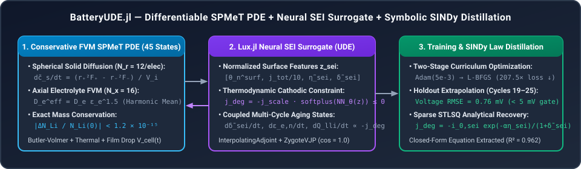
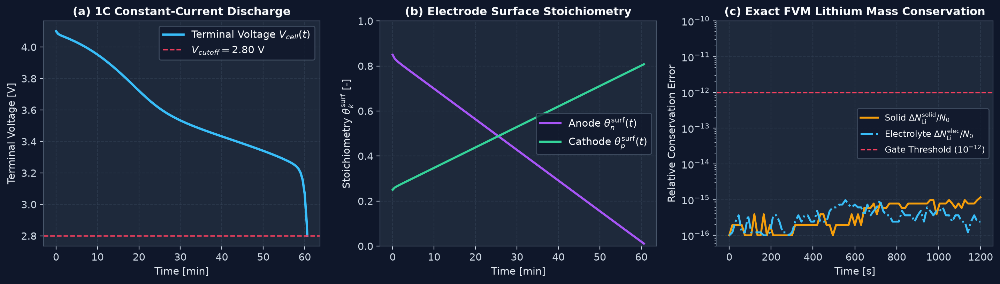
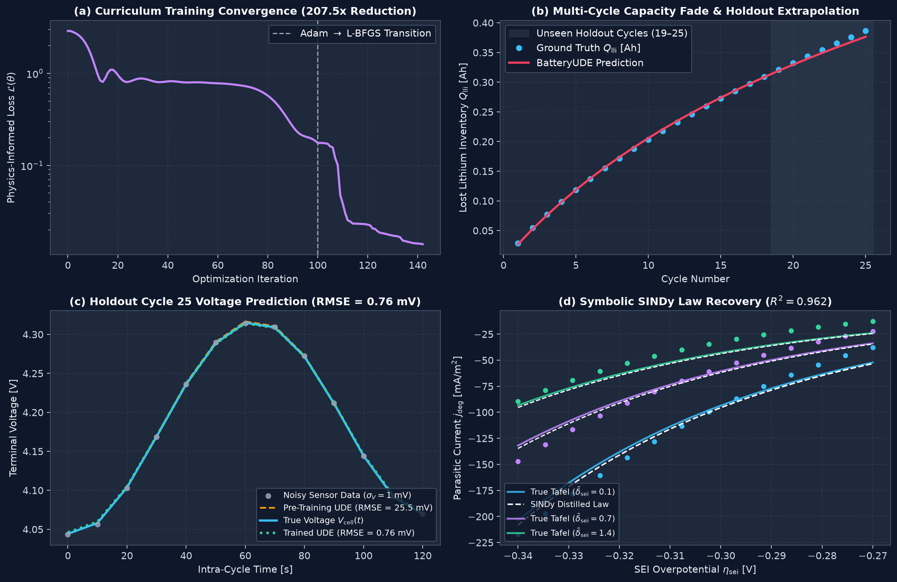

# BatteryUDE.jl

[](https://julialang.org/)
[](https://opensource.org/licenses/MIT)

A finite-volume Single Particle Model with Electrolyte and Thermal coupling (SPMeT) with a `Lux.jl` neural network embedded in the SEI degradation term, solved as a universal differential equation with `OrdinaryDiffEq.jl` and `SciMLSensitivity.jl`.

The network is trained on noisy voltage and capacity data from cycling. Afterwards, sparse regression (SINDy, STLSQ) turns the trained network back into a closed-form rate law. The discretization conserves lithium to round-off: relative drift is about 1e-15.

<p align="center">
  
</p>

## Features

- **Conservative FVM.** Spherical particles (2 × 12 shells) and a 16-cell axial electrolyte with harmonic-mean face diffusivities. Solid and electrolyte lithium inventory are conserved to ~1e-15 relative error.
- **Sign-constrained SEI current.** The network output goes through `-j_scale * softplus(NN(z_sei))`, so the side-reaction current is always cathodic (≤ 0).
- **Adjoint gradients.** `ude_rhs` is out-of-place and doesn't mutate, so it works with `InterpolatingAdjoint(autojacvec=ZygoteVJP())` and `Rodas5P()`. Through the stiff `Rodas5P` solve, adjoint gradients agree with `ForwardDiff` to a relative error of 2.6e-10.
- **SINDy distillation.** STLSQ on column-normalized features recovers the Tafel-diffusion form of the SEI rate from the trained network.

## Results

SPMeT forward simulation, 1C discharge:

<p align="center">
  
</p>

UDE training, holdout extrapolation and SINDy recovery:

<p align="center">
  
</p>

| Check | Target | Result |
| :--- | :--- | :--- |
| Solid Li conservation (`test_conservation.jl`) | rel. error < 1e-12 | 1.166e-15 |
| Electrolyte Li conservation (`test_conservation.jl`) | rel. error < 1e-12 | 9.691e-16 |
| 1C discharge (`test_forward_physics.jl`) | V(0) in [4.1, 4.3] V, monotonic to 2.8 V | 4.101 V → 2.800 V at t = 3637.7 s |
| Adjoint vs. ForwardDiff through `Rodas5P` (`test_adjoint_grads.jl`) | cos sim > 0.999, rel. error < 1e-4 | cos = 1.0, rel. error = 2.6e-10 |
| Training, Adam + L-BFGS | loss reduced ≥ 100× | 207.5× (2.892 → 1.394e-2) |
| Holdout voltage RMSE, cycles 19–25 | < 5 mV | 0.759 mV (untrained: 25.51 mV) |
| SINDy fit of SEI rate | recover the hidden law | `j_deg = -0.0003064 exp(-α η_sei) / (1 + δ̃_sei)`, R² = 0.962 |

The last three rows come from `scripts/train_synthetic_twin.jl`, not the test suite.

## Usage

Run the tests:

```bash
julia --project=. -e 'using Pkg; Pkg.test()'
```

Run the full synthetic training and SINDy example:

```bash
julia --project=. scripts/train_synthetic_twin.jl
```

From Julia:

```julia
using BatteryUDE, Random

rng  = Random.MersenneTwister(2026)
cell = chen2020_params()  # NMC811/graphite, 5.0 Ah, 45 states

# 25 cycles of synthetic data with 1 mV Gaussian voltage noise; first 18 used for training
dataset = generate_synthetic_twin_data(cell; N_cycles=25, train_cycles=18, rng=rng)

model = HybridSPMeTModel(cell; rng=rng, hidden_dim=24, j_scale=0.30)

# Adam (lr 5e-3, 100 iters), then L-BFGS (40 iters)
train_res = train_battery_ude!(model, dataset; adam_lr=5e-3, adam_iters=100, lbfgs_iters=40)

sindy_res = distill_sei_sindy(model, train_res.p_trained)
println(sindy_res.equation_str)
# j_deg(t) = -0.0003064 * exp(-alpha * eta_sei) / (1 + delta_sei_tilde)
```

## Model

### State vector

There are $D = 2N_r + N_x + 5 = 45$ states, each scaled to roughly unit magnitude so the stiff `Rodas5P` solve stays well conditioned:

- `u[1 : N_r]`: $\tilde{c}_{s,n} = c_{s,n} / c_{s,n}^{\max}$, anode solid concentration ($N_r = 12$)
- `u[N_r+1 : 2N_r]`: $\tilde{c}_{s,p} = c_{s,p} / c_{s,p}^{\max}$, cathode solid concentration
- `u[2N_r+1 : 2N_r+N_x]`: $\tilde{c}_e = c_e / c_{e,0}$, electrolyte concentration ($N_x = 6 + 4 + 6 = 16$)
- `u[2N_r+N_x+1]`: $\tilde{\delta}_{\text{sei}} = \delta_{\text{sei}} / 10^{-7}\,\text{m}$, SEI thickness
- `u[2N_r+N_x+2]`: $\varepsilon_{e,n}$, anode porosity (reduced by pore clogging)
- `u[2N_r+N_x+3]`: $\varepsilon_{s,n}$, anode active material fraction
- `u[2N_r+N_x+4]`: $Q_{\text{lli}}$, cumulative lithium inventory loss [A·h]
- `u[2N_r+N_x+5]`: $\tilde{T} = (T - 298.15) / 10$, cell temperature

### SEI kinetics

The network input is

$$\mathbf{z}_{\text{sei}} = \left[\theta_n^{\text{surf}},\; j_{\text{tot},n}/10,\; (U_n(\theta_n^{\text{surf}}) + \eta_{\text{int},n}^{\text{approx}} - 0.4)/0.05,\; \tilde{\delta}_{\text{sei}}\right]^T$$

and its output sets the degradation current:

$$j_{\text{deg}} = -j_{\text{scale}} \cdot \text{softplus}\left(\mathcal{N}_{\theta}(\mathbf{z}_{\text{sei}})\right) \le 0, \qquad j_{\text{int},n} = j_{\text{tot},n} - j_{\text{deg}}$$

$$\frac{d\tilde{\delta}_{\text{sei}}}{dt} = -\frac{M_{\text{sei}}}{2 F \rho_{\text{sei}} \delta_{\text{scale}}} j_{\text{deg}}, \qquad \frac{d\varepsilon_{e,n}}{dt} = -a_{s,n} \delta_{\text{scale}} \frac{d\tilde{\delta}_{\text{sei}}}{dt}, \qquad \frac{dQ_{\text{lli}}}{dt} = -\frac{A_{\text{cell}} L_n a_{s,n}}{3600} j_{\text{deg}}$$

## Layout

```text
src/
  BatteryUDE.jl           module and exports
  parameters.jl           CellParams, Chen2020 (NMC811/graphite) defaults
  fvm_discretization.jl   spherical and axial FVM stencils
  electrochemistry.jl     OCP curves, Butler-Volmer, terminal voltage
  neural_surrogates.jl    Lux SEI and LAM networks
  hybrid_ode.jl           coupled SPMeT + UDE ODEProblem, voltage cutoff callbacks
  training.jl             adjoint loss, synthetic data generator, Adam + L-BFGS
  sindy_distillation.jl   SINDy distillation of the trained network
scripts/
  train_synthetic_twin.jl end-to-end training and law recovery
test/
  test_conservation.jl    lithium conservation
  test_forward_physics.jl 1C discharge curve and voltage bounds
  test_adjoint_grads.jl   adjoint vs. ForwardDiff gradients
```
